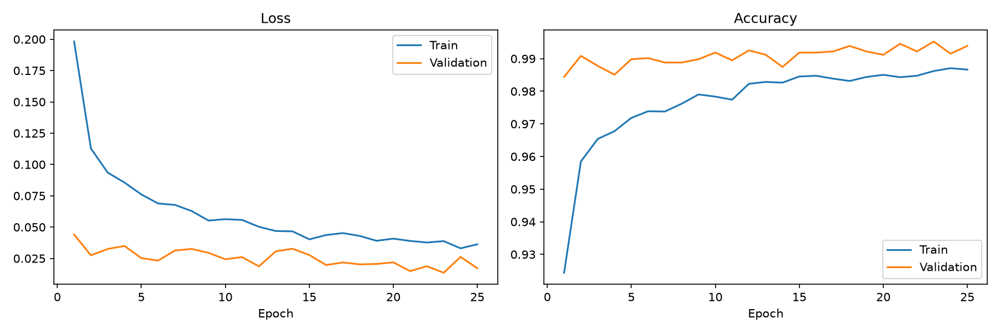

# COVID-19 CT Scan Classifier

A PyTorch image classifier that sorts chest CT slices into three classes: normal, COVID-19 positive and non-informative. It uses transfer learning on MobileNetV3-Large and reaches **99.59% accuracy** on a held-out test set of 2,956 slices (see [Limitations](#limitations) for why this number is optimistic).

> This is a learning project. It is not a medical device and must not be used to make decisions about anyone's health.

## The task

Each image is a single slice from a chest CT scan. The model assigns it to one of three classes:

| Class | Meaning | Images |
|---|---|---:|
| `nCT` | Normal: the lungs are visible and healthy | 9,979 |
| `pCT` | Positive: the lungs show signs of COVID-19 pneumonia | 4,001 |
| `NiCT` | Non-informative: the slice does not show enough of the lungs to judge | 5,705 |

## Results

| Split | Images | Accuracy |
|---|---:|---:|
| Validation | 2,951 | 99.53% |
| **Test** | **2,956** | **99.59%** |

Per-class metrics on the test set:

| Class | Precision | Recall | F1 | Recall 95% CI |
|---|---:|---:|---:|---:|
| NiCT | 99.19% | 99.65% | 0.994 | 99.0–99.9% |
| nCT | 99.73% | 99.80% | 0.998 | 99.4–99.9% |
| pCT | 99.83% | 99.00% | 0.994 | 97.8–99.5% |

As a COVID-19 detector (pCT versus the other two classes), the model has a **sensitivity of 99.00%** (6 of 601 positive slices missed, 95% CI 97.8–99.5%) and a **specificity of 99.96%** (1 false alarm on 2,355 other slices).

Confusion matrix on the test set (rows = true class, columns = predicted class):

| | NiCT | nCT | pCT |
|---|---:|---:|---:|
| **NiCT** | 854 | 3 | 0 |
| **nCT** | 2 | 1,495 | 1 |
| **pCT** | 5 | 1 | 595 |

Ten of the 12 errors involve the non-informative class: slices at the edge of the lungs, where it is ambiguous whether enough lung is visible to judge. One COVID-positive slice was classified as normal, which is the most serious type of error for this task.



## How it works

- **Data:** the slices are split per class into 70% training, 15% validation and 15% test, with a fixed seed (42). Training images are augmented with random resized crops and horizontal flips. All images are normalized with the ImageNet statistics.
- **Model:** MobileNetV3-Large pretrained on ImageNet. Its original 1,000-class head is replaced by a new one: 960 → 1,280 (ReLU, 20% dropout) → 3. The whole network is fine-tuned (4.2M trainable parameters).
- **Training:** cross-entropy loss, AdamW (learning rate 1e-4, weight decay 1e-4), batch size 16, 25 epochs. The model with the best validation accuracy is kept.
- **Hardware:** Apple Silicon MacBook, PyTorch MPS backend. Training took about 64 minutes.

## Project structure

```
covid_ct/           shared code: settings, data, model, training loops, metrics
train.py            trains the model and saves it with its history and curves
evaluate.py         full evaluation of the trained model
predict.py          classifies one or more images
classifier.ipynb    the same pipeline step by step, with explanations and plots
```

## Getting started

```bash
git clone https://github.com/aymanbelbachir/covid-ct-classifier.git
cd covid-ct-classifier
python3 -m venv .venv
source .venv/bin/activate
pip install -r requirements.txt
```

Download the dataset from [Kaggle](https://www.kaggle.com/datasets/azaemon/preprocessed-ct-scans-for-covid19) and move the `nCT`, `NiCT` and `pCT` folders from `Original CT Scans` into a `data/` folder:

```
data/
├── NiCT/
├── nCT/
└── pCT/
```

Then run the scripts from the project folder:

```bash
python train.py                          # train the model (about 1 hour on Apple Silicon)
python evaluate.py                       # accuracy, precision, recall, F1, sensitivity, specificity
python evaluate.py --split val           # the same on the validation set
python predict.py data/pCT/pCT3689.jpg   # classify one or more images
```

`train.py` saves the best model to `outputs/best_model.pth`, the history of every epoch to `outputs/history.json` and the training curves to `assets/training_curves.png`. You can also open `classifier.ipynb` with `jupyter notebook` and run all cells.

## Limitations

- **The split is per slice, not per patient, and this inflates the test score.** Neighbouring slices of the same scan are nearly identical and end up on both sides of the split: 97% of the test slices have a training slice with a pixel correlation above 0.99 (on 64×64 thumbnails), and a simple nearest-neighbour lookup on those thumbnails, with no learning at all, scores 99.66% on the test set. The reported numbers therefore mostly measure how well the model recognises slices it has almost seen, not how it would do on new patients. The dataset also contains 55 pairs of byte-identical images, 6 of which have one copy in the training set and one in the test set. A per-patient split would need patient IDs, which this version of the dataset does not include.
- **One data source.** All scans come from two hospitals in Wuhan. The model has not been tested on other scanners or populations.
- **Single slices only.** A real diagnosis looks at the whole scan together with symptoms and lab results.

## Acknowledgements

- Dataset: [CT Scans for COVID-19 Classification](https://www.kaggle.com/datasets/azaemon/preprocessed-ct-scans-for-covid19) (CC BY 4.0), built from the iCTCF data of Ning et al. (2020).
- Model: Howard et al., "Searching for MobileNetV3", ICCV 2019. Pretrained weights from torchvision.
