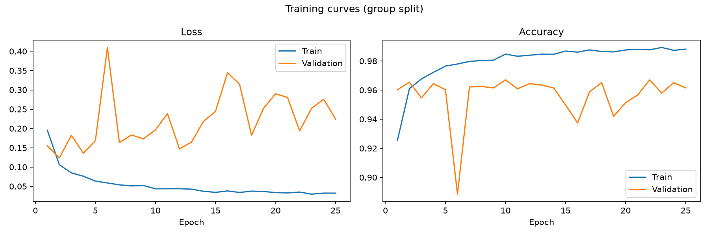
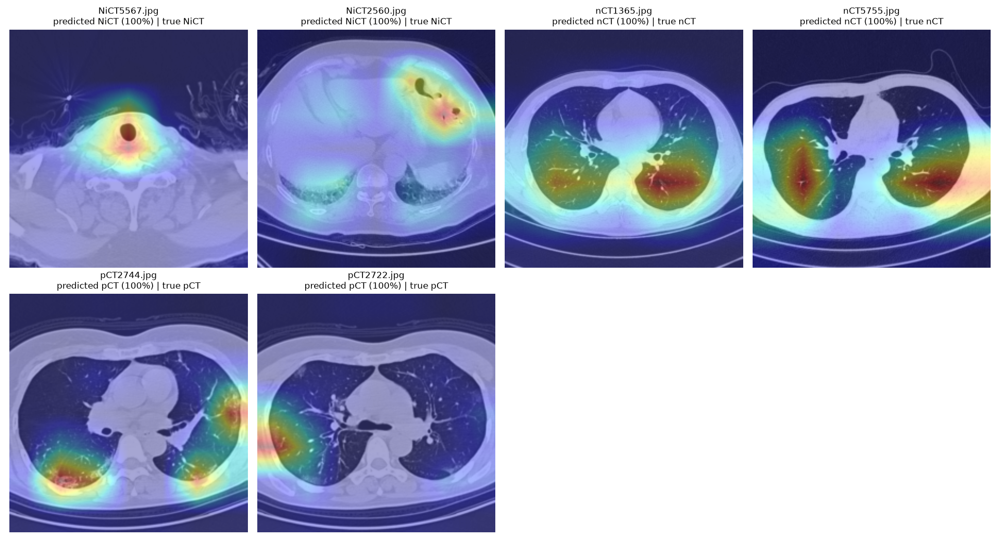

# COVID-19 CT Scan Classifier

A deep learning project that classifies chest CT slices into three classes: normal, COVID-19 positive and non-informative. It fine-tunes a pretrained MobileNetV3-Large in PyTorch and reaches **96.9% accuracy on 29 CT scans held out from training**, with a **99.5% specificity** for COVID-19 and all 8 COVID-positive test scans detected.

- **Transfer learning:** MobileNetV3-Large pretrained on ImageNet, fine-tuned on 19,685 CT slices
- **Scan-level data split:** near-identical slices of the same scan are kept together, so the test set measures performance on unseen scans
- **Complete evaluation:** precision, recall, F1, sensitivity, specificity, confidence intervals and scan-level results
- **Explainability:** Grad-CAM heatmaps show which regions of the image drive each prediction
- **Command-line tools:** training, evaluation, prediction and Grad-CAM scripts, plus a step-by-step notebook
- **Apple Silicon:** trains on the Mac GPU through PyTorch's MPS backend

> This is a learning project. It is not a medical device and must not be used to make decisions about anyone's health.

## The task

Each image is a single slice from a chest CT scan. The model assigns it to one of three classes:

| Class | Meaning | Images |
|---|---|---:|
| `nCT` | Normal: the lungs are visible and healthy | 9,979 |
| `pCT` | Positive: the lungs show signs of COVID-19 pneumonia | 4,001 |
| `NiCT` | Non-informative: the slice does not show enough of the lungs to judge | 5,705 |

## Results

Test set: 2,567 slices from 29 scans that the model never saw during training.

| Metric | Value |
|---|---:|
| Accuracy | 96.88% |
| Macro F1 | 0.965 |
| COVID-19 sensitivity | 89.96% |
| COVID-19 specificity | 99.50% |
| COVID-positive scans detected | 8 of 8 |

| Class | Precision | Recall | F1 |
|---|---:|---:|---:|
| NiCT | 96.97% | 99.61% | 0.983 |
| nCT | 96.38% | 98.24% | 0.973 |
| pCT | 98.01% | 89.96% | 0.938 |

Confusion matrix (rows = true class, columns = predicted class):

| | NiCT | nCT | pCT |
|---|---:|---:|---:|
| **NiCT** | 769 | 2 | 1 |
| **nCT** | 13 | 1,225 | 9 |
| **pCT** | 11 | 44 | 493 |



Validation accuracy reaches about 96% within the first epochs. The model from the epoch with the best validation accuracy is kept.

### Where the model looks

[Grad-CAM](https://arxiv.org/abs/1610.02391) highlights the regions of the image that drove the prediction (red = most important). On COVID-positive slices the model focuses on the opacities in the lungs, on normal slices it scans both lungs, and on non-informative slices it relies on the anatomy around them, such as the neck or the abdomen.



## How it works

1. **Data split.** Neighbouring slices of a CT scan are almost identical, so splitting the dataset slice by slice would put near-copies of training slices in the test set. `find_groups.py` links slices whose pixel correlation is above 0.95 and turns each chain of linked slices into a group, a proxy for one scan. The 189 groups are split into training (137), validation (23) and test (29), stratified by class, and `check_leakage.py` confirms that no test slice has a near-copy in the training set.
2. **Preprocessing.** Images are resized to 224 x 224 and normalized with the ImageNet statistics. Training images are augmented with random resized crops and horizontal flips.
3. **Model.** MobileNetV3-Large pretrained on ImageNet. Its 1,000-class head is replaced by a new one: 960 → 1,280 (ReLU, 20% dropout) → 3. The whole network is fine-tuned (4.2M trainable parameters).
4. **Training.** Cross-entropy loss, AdamW (learning rate 1e-4, weight decay 1e-4), batch size 16, 25 epochs, about 85 minutes on an Apple Silicon MacBook.
5. **Evaluation.** Per-class precision, recall and F1, COVID-19 sensitivity and specificity with 95% confidence intervals, and a summary per scan.

## Project structure

```
covid_ct/              shared package
├── config.py          paths, classes and hyperparameters
├── splits.py          train / validation / test split
├── similarity.py      thumbnails and similarity search to group slices
├── data.py            transforms and data loaders
├── model.py           MobileNetV3-Large with the new classification head
├── engine.py          training and evaluation loops
├── metrics.py         precision, recall, F1, sensitivity, specificity
└── gradcam.py         Grad-CAM heatmaps
find_groups.py         groups slices into scans and writes splits/group_split.csv
check_leakage.py       checks that the test set has no near-copy in the training set
train.py               trains the model and saves it with its history and curves
evaluate.py            evaluates the trained model on the test set
gradcam.py             draws Grad-CAM heatmaps for test images or your own images
predict.py             classifies one or more images
app.py                 web demo (Gradio): upload a slice, get the prediction and its heatmap
deploy_space.py        publishes the web demo on Hugging Face Spaces
examples/              example slices from the test set, used by the demo
classifier.ipynb       the whole pipeline step by step, with explanations
```

## Getting started

```bash
git clone https://github.com/aymanbelbachir/covid-ct-classifier.git
cd covid-ct-classifier
python3 -m venv .venv
source .venv/bin/activate
pip install -r requirements.txt
```

Download the dataset from [Kaggle](https://www.kaggle.com/datasets/azaemon/preprocessed-ct-scans-for-covid19) and move the `nCT`, `NiCT` and `pCT` folders from `Original CT Scans` into a `data/` folder:

```
data/
├── NiCT/
├── nCT/
└── pCT/
```

Then run the scripts from the project folder:

```bash
python train.py                           # train the model (about 1.5 hours on Apple Silicon)
python evaluate.py                        # evaluate it on the test scans
python gradcam.py --examples 2            # Grad-CAM heatmaps, saved to assets/gradcam.png
python predict.py data/pCT/pCT1227.jpg    # classify one or more images
python app.py                             # web demo at http://127.0.0.1:7860
```

The split is included in `splits/group_split.csv`, so `find_groups.py` only needs to be run to change the grouping threshold.

## Limitations

- **No patient IDs.** The groups of similar slices are a proxy for patients: distant slices of the same patient could still end up in both the training and the test set. The test set contains 29 scans, 8 of them with COVID-positive slices, which limits the precision of the results.
- **Missed COVID-positive slices.** About 10% of the COVID-positive slices are classified as normal or non-informative, mostly in a few scans. Scans acquired differently from the majority, for example with a circular field of view, are harder for the model.
- **One data source.** All scans come from two hospitals in Wuhan. The model has not been tested on other scanners or populations.
- **Overconfident probabilities.** The model often gives probabilities close to 100%, including on its errors; they are not calibrated.
- **Single slices only.** A real diagnosis looks at the whole scan together with symptoms and lab results.

## Acknowledgements

- Dataset: [CT Scans for COVID-19 Classification](https://www.kaggle.com/datasets/azaemon/preprocessed-ct-scans-for-covid19) (CC BY 4.0), built from the iCTCF data of Ning et al. (2020).
- Model: Howard et al., "Searching for MobileNetV3", ICCV 2019. Pretrained weights from torchvision.
- Grad-CAM: Selvaraju et al., "Grad-CAM: Visual Explanations from Deep Networks via Gradient-based Localization", ICCV 2017.
